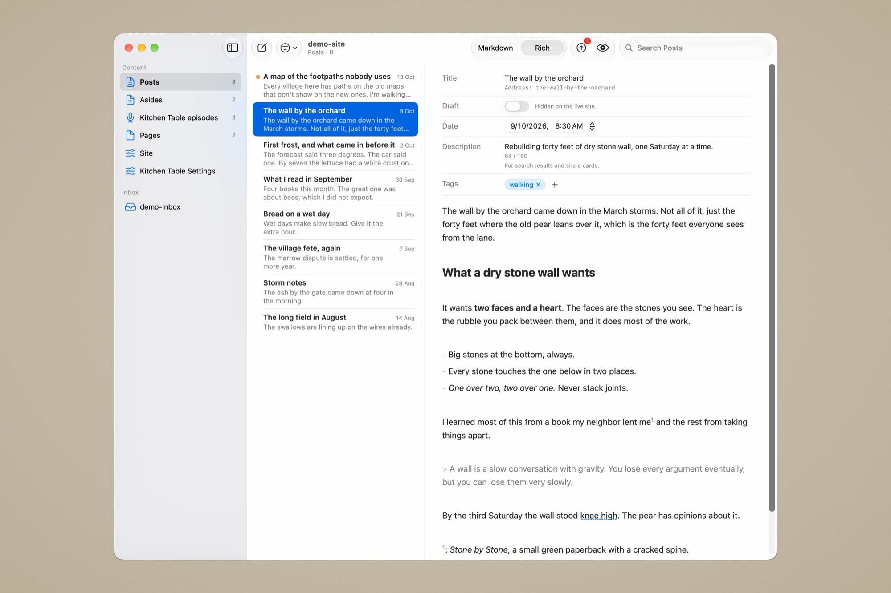

# Canteiro

A native Mac editor for an Astro site that uses [Keystatic](https://keystatic.com). It makes its forms from the site's own `keystatic.config.ts`, edits the markdown, YAML and JSON files in place, uploads photos and podcast audio to Cloudflare R2, and publishes by committing and pushing with git.



It started as the editor for one site and is in daily use there, but nothing about any site is written into the app. What Canteiro can't learn from the Keystatic config comes from a small `canteiro.json` in the site's repo, so any Keystatic site should open.

## What it does

- **Forms from your Keystatic config.** Every collection and singleton gets a sidebar row and a form, with Keystatic's labels, help text, options, defaults and limits. Add a field in Keystatic and it shows up in Canteiro.
- **Edits the files themselves.** No database and no copy of your content. A save changes only the lines you changed, so git diffs stay small, and it never writes over a change made on disk by something else.
- **Markdown or Read.** Two views of the same text: one with the marks faded, one with them hidden and the result shown. The file is always exactly what you typed.
- **Photos to R2.** Drop a photo into the body. It's resized, converted to WebP, stripped of its metadata (location included), uploaded and linked.
- **Podcast episodes from an MP3.** Drop an MP3 on a show's list and it becomes a draft episode with its number, guid and duration filled in.
- **An inbox for drafts written elsewhere,** such as iA Writer in iCloud, ready to finish and import.
- **Quick asides** from a small window, or from any app with a global shortcut.
- **Open in Browser** with the site's own `astro dev` server, drafts included, and **Publish**: pick the changed files, read their diffs, commit and push.

## What it needs

- **macOS 26** (Tahoe) or later.
- **An Astro site with a `keystatic.config.ts`** at the root of its repo, with `node_modules` installed. Keystatic's [Astro guide](https://keystatic.com/docs/installation-astro) sets one up.
- **Node** (Homebrew's is fine) and **git**, already signed in to your remote.
- For photos: **`cwebp`** (`brew install webp`) and **a Cloudflare R2 bucket** with a public address. Without them, everything else still works.

## Install

Download `Canteiro-<version>.zip` from [Releases](https://github.com/amongthestones/canteiro/releases/latest), unzip it, and move `Canteiro.app` to Applications. It's signed and notarized, so it opens like any other app. There are no automatic updates yet; what's new in each version is in the [changelog](CHANGELOG.md).

To make it from the sources instead (Xcode 26 or its command line tools):

```sh
git clone https://github.com/amongthestones/canteiro.git
cd canteiro
./scripts/package-app.sh   # makes Canteiro.app and installs it in /Applications
```

## First run

No Keystatic site of your own yet? The [demo site](demo/README.md) has one of everything: `npm install` in `demo/`, then open that folder.

1. **Open your site:** File › Open Site… (⌘O), and choose the folder with `keystatic.config.ts`. File › Open Recent switches between sites you've opened, and each one comes back where you left it. If the config can't be read, the window says why: usually Node wasn't found or `node_modules` is missing.
2. **Add a `canteiro.json`** to the site's repo if you want uploads, MP3 import, the inbox or your site's own markdown extras. Every part is optional:

   ```json
   {
     "uploads": {
       "bucket": "my-site-media",
       "publicBase": "https://media.example.com"
     },
     "podcasts": { "collections": ["episodes-*"] }
   }
   ```

   All the options are in [canteiro.json](docs/canteiro-json.md).
3. **For uploads,** open Settings (⌘,), enter your Cloudflare account ID and R2 API token, and choose Save and Check. The token is kept in your keychain.

## Limits

- **Keystatic only.** A site described only by Astro's own collection schemas won't open.
- **R2 only** for photos and audio, for now (see the [roadmap](#roadmap)). Image fields save into the repo instead.
- **One site and one person at a time.** No accounts, sharing or locking.
- **Mac only.** The inbox is the way to write on a phone.
- **Some fields are shown but not edited:** Keystatic's `document` and other rich-content fields, and image and file fields inside a list.

Canteiro sends nothing anywhere except your files to your own R2 bucket and your commits to your own git remote. No analytics, no crash reports, no account.

## Roadmap

- **Other storage services.** Uploads go only to Cloudflare R2 today. Support for other S3-compatible services, such as Amazon S3 or Backblaze B2, is on the way.

## More

- [Guide](docs/guide.md): the window, every field type, photos, podcast episodes, the inbox, opening in the browser, publish and keyboard shortcuts.
- [canteiro.json](docs/canteiro-json.md): everything the file can hold.
- [Development](docs/development.md): how it works, tests and the source files.

## The name

*Canteiro* is Galician for a stonemason. Canteiro was made for [Among the Stones](https://amongthestones.com). Its icon is a mason's mark, the sign masons cut into the stones they dressed. This one is a tau, taken from the coat of arms of Monforte de Lemos, the Galician town it comes from.

## License

MIT. See [LICENSE](LICENSE).
