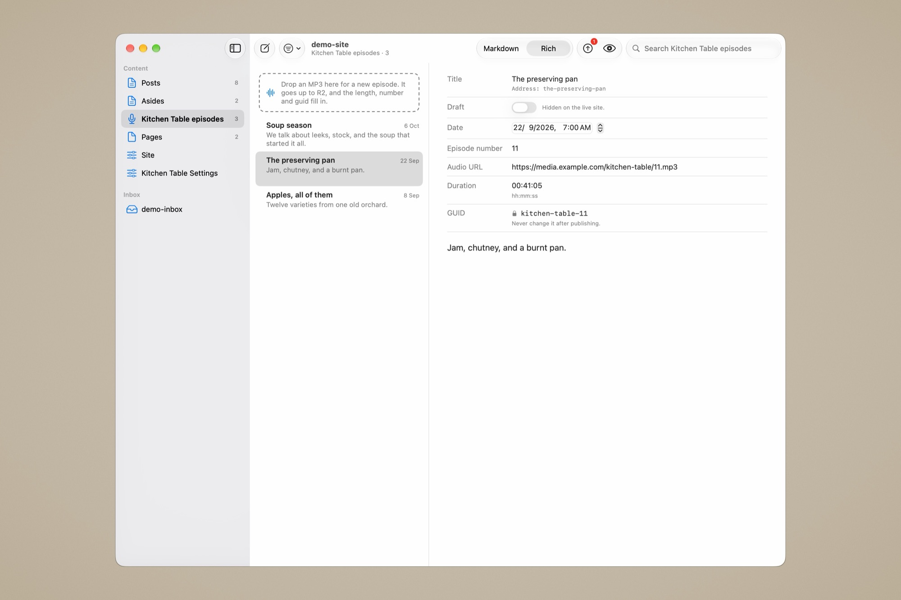
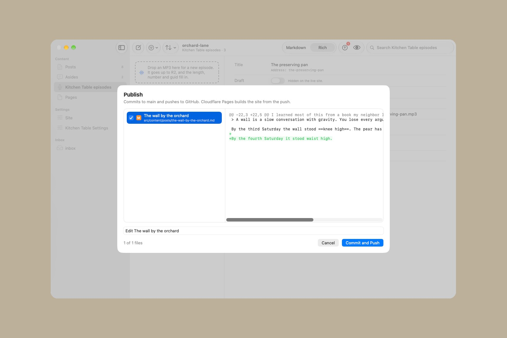

# Guide

How Canteiro works, part by part. For what goes in `canteiro.json`, see [canteiro.json](canteiro-json.md).

- [The window](#the-window)
- [Fields](#fields)
- [The body](#the-body)
- [Saving](#saving)
- [New entries, search and trash](#new-entries-search-and-trash)
- [Quick asides](#quick-asides)
- [Photos](#photos)
- [Podcast episodes](#podcast-episodes)
- [The inbox](#the-inbox)
- [Preview](#preview)
- [Publish](#publish)
- [Settings](#settings)
- [Keyboard shortcuts](#keyboard-shortcuts)

## The window

Three columns, like Mail.

- **Sidebar:** your collections and singletons, grouped the way your Keystatic config's `ui.navigation` groups them, with a count beside each collection. Anything the navigation leaves out goes in a last "Other" group, so nothing is hidden. Problems reading the site (a file that doesn't parse, a broken `canteiro.json`) are listed at the bottom.
- **List:** a collection's entries, newest first when it has a date field, else by its first number field. Drafts have an orange dot. Each row is the title, the date, and two lines of the text.
- **Editor:** the entry's fields on top and the body below. Fields that are empty and optional fold under "More fields", so the top stays short. Singletons skip the list and open straight into their form.
- **Toolbar:** New Entry, the list filter, search, Markdown or Rich, Publish (with a count of changed files) and Preview.

## Fields

Each Keystatic field type gets a native control. The names link to Keystatic's docs for setting up each field in your config.

| Keystatic field | In Canteiro |
|---|---|
| [`text`](https://keystatic.com/docs/fields/text) (one line or multiline), [`url`](https://keystatic.com/docs/fields/url) | a text field, with a character count when the field has a maximum length |
| [`slug`](https://keystatic.com/docs/fields/slug) | a text field with the address it makes shown under it |
| [`integer`](https://keystatic.com/docs/fields/integer) | a number field |
| [`checkbox`](https://keystatic.com/docs/fields/checkbox) | a switch |
| [`select`](https://keystatic.com/docs/fields/select) | a menu |
| [`multiselect`](https://keystatic.com/docs/fields/multiselect) | the picked choices as tokens, with a menu to add more, or a single menu when only one can be picked |
| [`date`](https://keystatic.com/docs/fields/date), [`datetime`](https://keystatic.com/docs/fields/datetime) | a date picker |
| [`relationship`](https://keystatic.com/docs/fields/relationship) | a picker over the entries of the related collection |
| [`array`](https://keystatic.com/docs/fields/array) | a list of items you can add to and remove from |
| [`object`](https://keystatic.com/docs/fields/object) | its fields, grouped in a box |
| [`conditional`](https://keystatic.com/docs/fields/conditional) | a menu that swaps in the fields for each choice. A new choice starts its fields fresh |
| [`image`](https://keystatic.com/docs/fields/image), [`file`](https://keystatic.com/docs/fields/file) | the file's name, a preview for an image, and Choose… and Remove. Drop a file on it to use that one |

A field type Canteiro doesn't know is shown as text and left alone. Unknown keys in a file's frontmatter are kept as they are.

Image and file fields follow Keystatic's rules, so either app can edit the entry:

- The file is named after the field, keeping its extension: a `cover` field gets `cover.jpg`.
- With `directory` set, the file goes there, in a folder named after the entry's slug in a collection (`src/assets/posts/my-post/cover.jpg`). Without it, the file goes in a folder next to the entry, named like it.
- The entry stores `publicPath`, the slug and the file name (`/src/assets/posts/my-post/cover.jpg`), or only the file name when there's no `publicPath`.
- A replaced file under another name, a removed one, and the files of an entry you move to the Trash all go to the Trash.
- Inside a list, the field is shown but not edited, since Keystatic names those files by each item.

These files are saved into the repo as they are and show up in Publish with the entry. Photos dropped into the body are different: they're resized and uploaded to R2.

## The body

The body editor grows with its text, so the fields and the body scroll together as one page. Smart quotes and dash substitution are off: markdown is saved as typed.

- **Markdown view:** a monospaced font, with the marks (`#`, `**`, `[`, `](…)`, table pipes) faded but visible.
- **Rich view (⌘R):** a reading font with the marks hidden. Headings are sized, bold and italics shown, links underlined, quotes and list markers set back, and tables laid out in columns with `:---:` alignment.

Rich is not a separate editor that converts to and from markdown. It's the same text drawn differently, so the file on disk is what you typed in either view.

Your site's own markdown extras can be styled too, if `canteiro.json` names them: `==highlights==`, iA Writer's `[^inline footnotes]`, `^^^callouts^^^` and `{{TOC}}`.

The Format menu writes the marks for you, with iA Writer's shortcuts. Each one takes its marks off again if they're already there. Link (⌘K) uses the URL on the clipboard: copy a link, select some words, press ⌘K, and they become `[words](https://…)`. With no URL on the clipboard, the caret waits in the `()` for one. Highlight and Footnote only work when `canteiro.json` names those extras, so they never write marks your site shows as plain text.

## Saving

- Changes save themselves a moment after you stop typing, on ⌘S, and when you leave the entry.
- In markdown and YAML files, a field you didn't touch keeps its original text, quoting and comments included. Changed and new fields are written the way Keystatic writes them.
- If the file changed on disk since Canteiro read it (another editor, a `git pull`), nothing is saved. A bar offers "Use the File on Disk" or "Keep My Version".

## New entries, search and trash

- **New Entry (⌘N)** asks for a title, shows the address it will make, and creates the file with your config's defaults. If the collection has a `draft` checkbox, the new entry starts as a draft so a publish can't put it on the site half-written. In an aside collection, ⌘N opens the quick aside window instead; in a podcast collection, it asks for an MP3.
- **Search** filters the list by title.
- **Filter** shows drafts or published entries, or the entries with a given choice in any select field.
- **Move to Trash** (Delete, or right-click) moves the file to the Finder's Trash, so a slip can be put back from there, or from git until it's published.

## Quick asides

For a collection of short dated posts with no body. Canteiro spots it by shape: a date field and a text field, no content field.

- File › New Aside (⇧⌘A) in the app, or **⌃⌥A from any app**. The global shortcut needs no Accessibility permission.
- Type, pick a language if the collection has a select field whose key starts with `lang`, and press ⌘↩ to save.
- A count shows the characters left, from the text field's maximum length in your config (280 if it has none).
- The file is named from the date and time, like `2026-10-04-1032`.

## Photos

Drop a photo (JPEG, PNG, HEIC and the rest) into the body. Before anything leaves the Mac:

1. it's turned upright and resized to 1400 pixels wide, never wider than the original,
2. converted to WebP at quality 75,
3. stripped of all metadata, GPS location included,
4. uploaded to your bucket, in the photo folder from `canteiro.json` (by default `uploads/YYYY/MM/`), under a web-safe version of its file name.

A placeholder marks the spot while it works, then becomes ``. Add alt text between the brackets. A progress bar shows each upload, and errors appear in the same bar.

## Podcast episodes

For collections `canteiro.json` names as podcasts. Drop an MP3 on the show's list, or choose New Entry and pick one. Canteiro:

1. reads its length,
2. uploads it to the show's audio folder (by default `podcasts/<show>/`, where the show is the collection's folder name),
3. creates a draft episode titled "Episode N", with the next episode number, a guid such as `myshow-5`, the duration as `HH:MM:SS`, the audio address and `audio/mpeg` as its type.

The guid locks once it's set, since podcast apps track an episode by it.

## The inbox

If `canteiro.json` has an `inbox`, a sidebar section lists the drafts in that folder, newest first. It's meant for a writing app that syncs a folder, such as iA Writer in iCloud: write anywhere, then finish and publish on the Mac.

- **Watching:** the list updates when files are added, changed or removed, and when you switch back to Canteiro. Files iCloud hasn't downloaded yet are fetched.
- **Editing:** select a draft to edit its file in place, with the same body editor as an entry. If the file changes elsewhere (your phone saved it) and you have no unsaved edits, the editor reloads; if you do, it asks which version to keep.
- **Import** makes the draft a new entry in the collection `canteiro.json` names, as a draft, and moves the file to an `Imported` folder inside the inbox, so each piece only lives in one place.
- **The title** comes from the draft's frontmatter `title`, else a `# heading` on its first line (taken out of the body, since your site shows the title), else the file name.
- **Frontmatter** in the draft is carried over for keys that match the collection's fields. Anything else stays in the draft. A tag that isn't in your site's tag list can still break the site's deploy, even on a draft.

Plain `.md`, `.markdown` and `.txt` files are listed. Folders and hidden files are skipped. Choose Folder… sets a different folder on this Mac only, over the one in `canteiro.json`.

## Preview

Preview (⌥⌘P) opens a window with the selected entry as your site renders it, using the collection's `previewUrl` from your Keystatic config.

- If an `astro dev` server is already running for this site, Canteiro uses it.
- If not, it starts one on a free port between 4321 and 4340, and stops it when Canteiro quits.

## Publish

Publish opens a sheet with every changed file and its diff. Untick any you don't want in this commit. Canteiro suggests a message from the titles of what changed ("Edit Morning Walk and Tags", "Add Field Notes"), which you can rewrite.

It commits exactly the files you picked, nothing else that's staged, and pushes to your current branch with the system `git`. Canteiro never asks for a password: a push that needs one fails with a message instead of hanging. If the push is turned down because the remote has newer commits, it offers to pull them first (a rebase that sets any other work in progress aside while it runs) and push again.

## Settings

Settings (⌘,) holds what belongs to your Mac, not your site:

- **General** checks the open site, its `keystatic.config.ts` and `canteiro.json`, where Publish pushes, the inbox folder, and the tools Canteiro runs (Node, git, `cwebp`, the site's packages), with a fix for anything missing. Canteiro looks for Node in `/opt/homebrew/bin`, `/usr/local/bin` and `~/.volta/bin`, then asks your login shell.
- **Uploads** holds your Cloudflare account ID and R2 API token (an access key ID and secret with Object Read & Write on the bucket). The token is stored in your login keychain, never in a file. Save and Check tries the bucket from the open site's `canteiro.json` with these keys.

The bucket and public address belong to the site and come from its `canteiro.json`. Settings shows them, read-only.

## Keyboard shortcuts

| Shortcut | Action |
|---|---|
| ⌘N | New entry in the selected collection |
| ⇧⌘A | New aside |
| ⌃⌥A | New aside, from any app |
| ⌘↩ | Save the aside |
| ⌘S | Save now |
| ⌘R | Switch between Markdown and Rich |
| ⌥⌘P | Show or hide Preview |
| ⌘O | Open a site |
| ⇧⌘R | Reload the site (rereads the config, the files and `canteiro.json`) |
| ⌘, | Settings |
| Delete | Move the selected entry to the Trash |

In the body, the Format menu follows iA Writer:

| Shortcut | Action |
|---|---|
| ⌘B / ⌘I | Bold / italic |
| ⌥⌘U / ⇧⌘U | Strikethrough / highlight |
| ⌘J / ⇧⌘J | Code / code block |
| ⌘K | Link, with the URL on the clipboard |
| ⌥⌘K / ⌃⌘K | Image / inline footnote |
| ⌘1 to ⌘6 | Heading 1 to 6 |
| ⇧⌘L / ⌥⌘L / ⌥⇧⌘L | Ordered list / task list / ordered task list |
| ⌥⌘X | Mark a task as done or not done |
| ⌥⌘↑ / ⌥⌘↓ | Move the line up or down |
